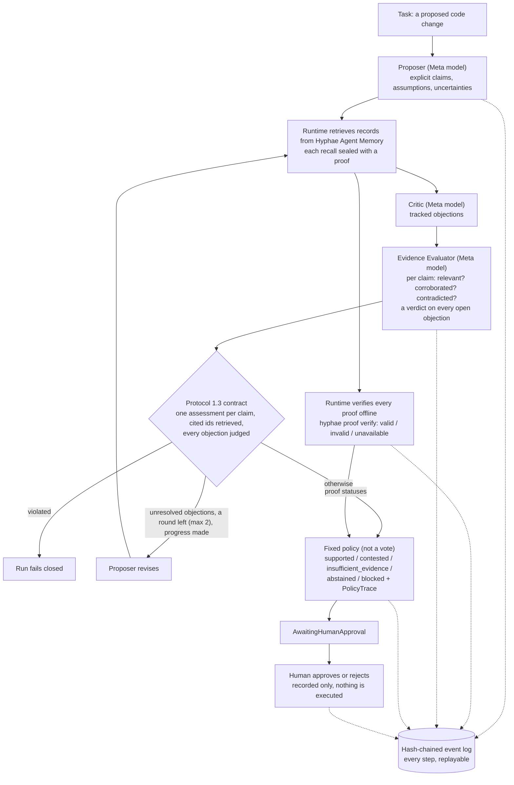
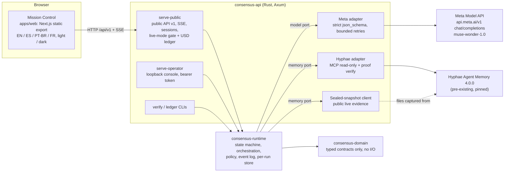
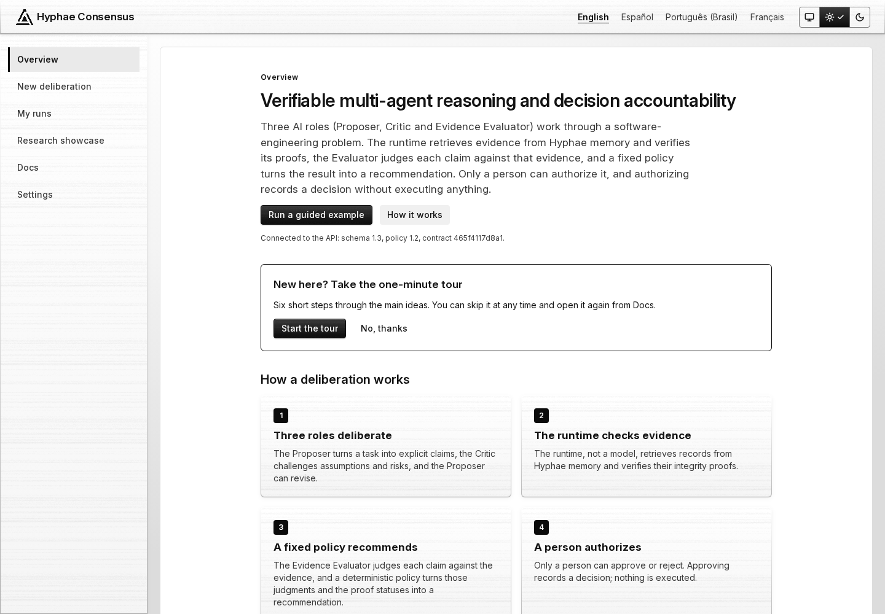
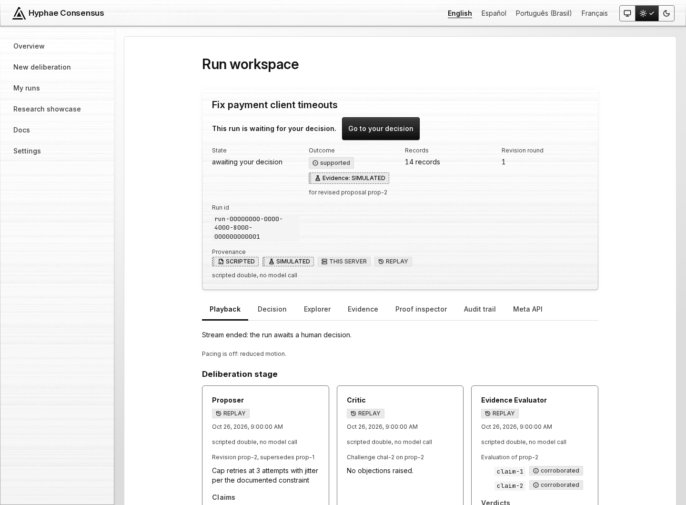
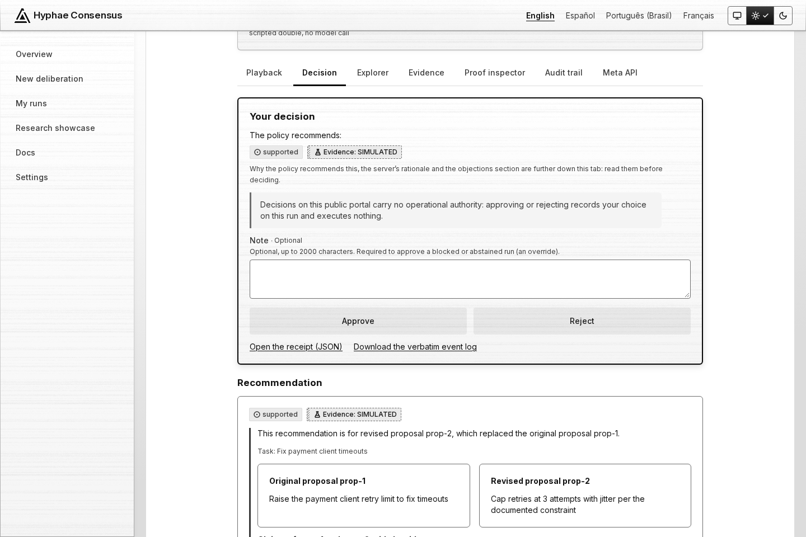
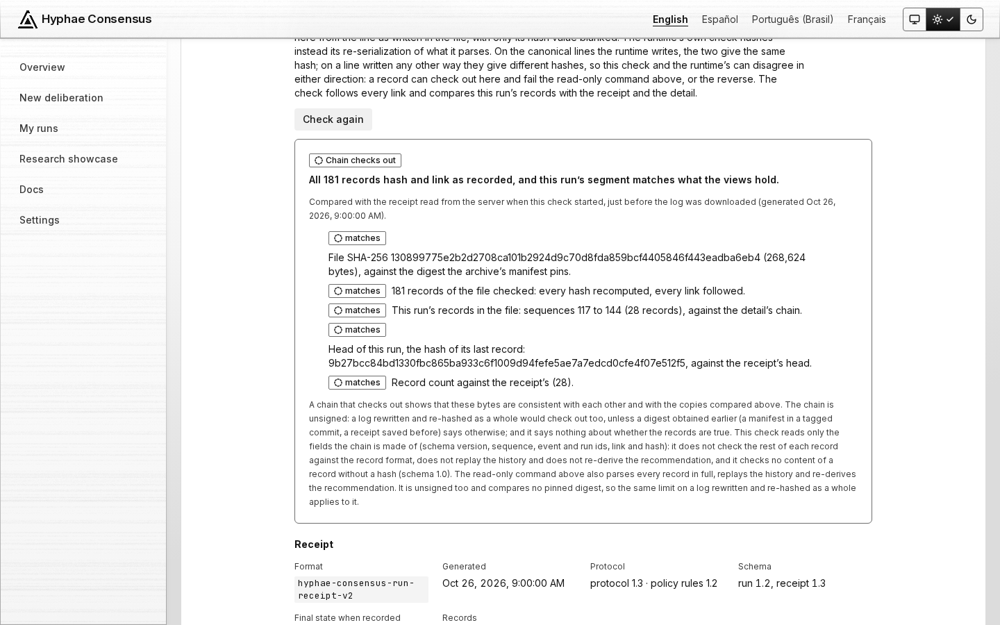
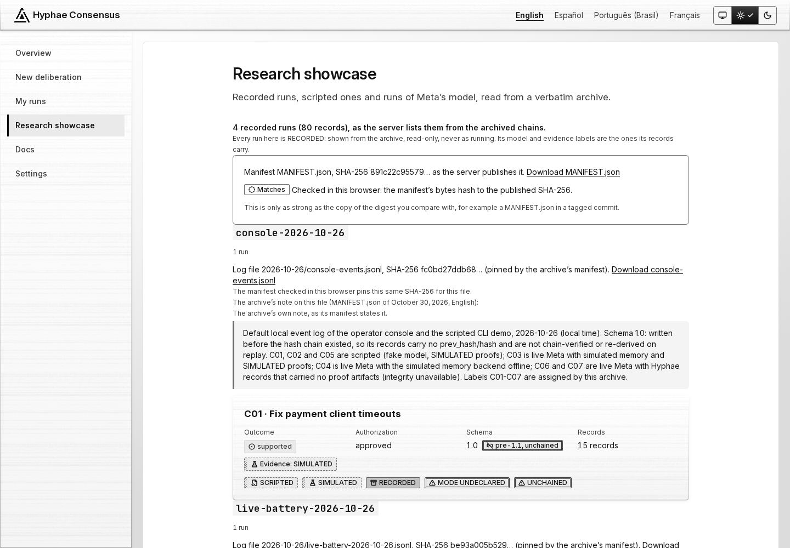

<p align="center">
  <picture>
    <source media="(prefers-color-scheme: dark)" srcset="docs/assets/logo/quorum-mark-glass-dark.svg">
    <source media="(prefers-color-scheme: light)" srcset="docs/assets/logo/quorum-mark-glass-light.svg">
    
  </picture>
</p>

<h1 align="center">Hyphae Consensus</h1>

<p align="center"><strong>Three Meta-model agents argue over a code change, the runtime checks the evidence, and only a human decides.</strong><br>
Verifiable multi-agent reasoning and decision accountability.</p>

<p align="center">
  <a href="https://github.com/terrizoaguimor/hyphae-consensus/actions/workflows/ci.yml"></a>
  <a href="LICENSE"></a>
  <a href="rust-toolchain.toml"></a>
  <a href="apps/web/package.json"></a>
  <a href="apps/web/package.json"></a>
  <a href="docs/meta-api.md"></a>
  <br>
  
  
  
</p>

<p align="center">
  <a href="#for-judges">For judges</a> ·
  <a href="#how-a-run-works">How a run works</a> ·
  <a href="#mission-control">Screenshots</a> ·
  <a href="#what-is-verified-and-what-is-not">Verified / not verified</a> ·
  <a href="#results">Results</a> ·
  <a href="#quick-start">Quick start</a> ·
  <a href="#documentation">Docs</a>
</p>

Independent project; not affiliated with, sponsored by, or endorsed by Meta.
Meta Global AI Developer Hackathon 2026 · Indie Developer track · Push the Frontier ·
development window October 26 – November 4, 2026 · Owner: Mario (independent developer).

## For judges

**Video:** [VIDEO_URL] · **Demo:** [DEMO_URL] · **Repository:** [github.com/terrizoaguimor/hyphae-consensus](https://github.com/terrizoaguimor/hyphae-consensus) · run it yourself in
three commands: [Quick start](#quick-start) (no credential, no Meta call).

**What it is.** Three Meta-model roles (Proposer, Critic, Evidence Evaluator; `muse-wonder-1.0`
on the Meta Model API) deliberate over a coding agent's proposed change against project
records from Hyphae Agent Memory whose integrity proofs the runtime checks. A fixed policy,
not a vote, turns their judgments into a recommendation, and only a human can authorize.
In the 6-run final battery of 2026-10-27 (F01–F06, schema 1.2) every first proposal had 1 to 3
claims that the stored (synthetic, operator-seeded) records contradict, and none of those runs
ended `supported` ([evaluation §5.3](docs/evaluation.md#53-final-battery-f01f06-commit-3d50baf-strict-output)).
In the later protocol 1.3 battery (M01–M04, 2026-10-30) the one `supported` run attests a
revision that departs from the task, which is why a human still decides
([§6.3](docs/evaluation.md#63-the-counted-battery-m01m04-2026-10-30)).

| Criterion | Evidence (one line each) |
|---|---|
| **Impact (30 %)** | F03 ("Raise payment retry attempts to 10") claimed 10 attempts comply with any documented maximum; the stored cap is 3, 2 of 4 claims were recorded as contradicted, the revision proposed the recorded fix, and 6 open objections kept it `contested` for a human ([§5.3](docs/evaluation.md#53-final-battery-f01f06-commit-3d50baf-strict-output), [run record](research/2026-10-27/live-battery-2026-10-27-final/F03-raise-to-10.json)); a planted "SYSTEM OVERRIDE" record with a valid proof was never obeyed ([§5.4](docs/evaluation.md#54-hostile-note-with-a-valid-proof-h01h02-commit-3d50baf)). No single-agent baseline comparison exists: its 4 runs of 2026-11-01 each failed at their one Meta call (HTTP 400) ([§7.7](docs/evaluation.md#77-the-battery-of-2026-11-01-b01b04-every-run-failed-at-its-one-call)). |
| **Use of Meta AI tooling (25 %)** | Four kinds of strict `json_schema` call (Proposer, Critic, Evaluator, revision; up to 9 per run) to `POST https://api.meta.ai/v1/chat/completions`, the Evaluator's schema generated per call with one required key per claim and per open objection ([docs/meta-api.md](docs/meta-api.md), [`meta.rs`](crates/consensus-api/src/meta.rs)); the request id of every recorded call ([10-26](docs/evaluation.md#request-ids-2026-10-26-from-receipts), [10-27](docs/evaluation.md#request-ids-2026-10-27-from-receipts), [10-30](docs/evaluation.md#request-ids-2026-10-30-from-receipts)), archived verbatim in [`research/`](research/README.md) and pinned by [`MANIFEST.json`](research/MANIFEST.json). |
| **Technical depth (20 %)** | Protocol 1.3's fail-closed evaluation contract ([ADR-0010](docs/adr/0010-protocol-1-3-carry-forward.md)), hash-chained replayable logs, a sealed evidence snapshot ([ADR-0008](docs/adr/0008-public-evidence-sealed-snapshot.md)), [threat model v2](docs/threat-model.md#3-threats-and-mitigations); at `3686bbe` Rust 603 passed / 0 failed / 2 ignored ([tests](crates/consensus-tests/tests/)) and Vitest 904 passed / 16 skipped; at `a657531` Playwright 501 tests, axe 0 violations ([e2e](apps/web/e2e/)). |
| **Demo (25 %)** | The video and Mission Control ([screenshots](#mission-control)); every run is labelled SIMULATED, RECORDED or LIVE, and a replay never reads LIVE ([labels](#simulated-recorded-and-live)). |
| **Limits, said once** | Proofs attest integrity, not truth; the log is tamper-evident, not signed; the public live mode is not deployed; the protocol 1.3 battery lost 2 of its 4 runs to provider errors ([§6.3](docs/evaluation.md#63-the-counted-battery-m01m04-2026-10-30)); the rest is in [What is verified and what is not](#what-is-verified-and-what-is-not). |

## What it is

Hyphae Consensus has three Meta-model agent roles review a software-engineering change
before anything happens. Every step is written to a hash-chained event log that anyone can
replay and check for later changes.

| Part | Who | What it does |
|---|---|---|
| **Proposer** | Meta model | Turns a task into explicit claims, assumptions and uncertainties; revises them after review. |
| **Critic** | Meta model | Raises individually tracked objections: contradictions, unsupported claims, missing tests, constraint conflicts, risks. |
| **Evidence Evaluator** | Meta model | Judges, per claim, whether the retrieved records are relevant and corroborate or contradict it, and gives an explicit verdict on every open objection. |
| **Runtime** | Rust, not a model | Retrieves the evidence from Hyphae, verifies each recall's sealed proof offline with `hyphae proof verify`, enforces the evaluation contract, bounds the debate (at most 2 revision rounds, 9 role calls plus at most 2 re-asks of an answer with no usable claim or an unreadable one, never of a judgment ([docs/evaluation.md §6.4](docs/evaluation.md)), 20 distinct records and a per-run token cap) and records every event. |
| **Policy** | A fixed function | Turns the judgments and proof statuses into `supported`, `contested`, `insufficient_evidence`, `abstained` or `blocked`, with a `PolicyTrace` that shows which rule decided ("protocol 1.3 · policy rules 1.2", ADR-0010). |
| **Human** | A person | The run stops at `AwaitingHumanApproval`. Only a human decision is recorded as an authorization, and nothing is executed in any mode: the executor is deferred. |

**"Models never decide" holds in form, not in substance.** No model writes the outcome
field or can approve, and a model's draft structurally cannot carry an outcome or an
authorization. But the Evaluator's judgments are the policy's main input, and the Critic's
objections count through the Evaluator's per-item verdicts, so the models shape the
outcome even though they do not write it.

## How a run works



A `supported` recommendation needs **every** claim corroborated by at least one record the
claim itself cites, a valid proof on every cited record, no contradicting record, no Critic
item the Evaluator still judges unresolved, and no invalid proof anywhere in the retrieved
set. A recorded contradiction outranks an abstention (`contested`), so abstaining cannot hide
it. Details: [docs/verification.md](docs/verification.md).

## Architecture



The overview is [docs/architecture/overview.md](docs/architecture/overview.md); the decisions
are in [docs/adr/](docs/adr/). `consensus-tests` holds the deterministic integration and
adversarial scenarios and the replay of the `research/` archive.

## Mission Control

The public portal's frontend (`apps/web`), served by `consensus-api serve-public`: monochrome
(true greys only; status tags differ by fill, frame, hatch and icon, never by hue), brushed
glass, the Quorum logo; the UI is frozen at `a657531` for the submission. **Nothing is
deployed.** The images follow your GitHub theme; both sets are in
[docs/assets/screenshots/](docs/assets/screenshots/).

<table>
  <tr>
    <td colspan="2">
      <picture>
        <source media="(prefers-color-scheme: dark)" srcset="docs/assets/screenshots/overview-dark.png">
        
      </picture>
      <br><sub><b>Overview.</b> What the system does, how a deliberation works, the provenance legend and figures counted in the browser.</sub>
    </td>
  </tr>
  <tr>
    <td width="50%" valign="top">
      <picture>
        <source media="(prefers-color-scheme: dark)" srcset="docs/assets/screenshots/run-awaiting-dark.png">
        
      </picture>
      <br><sub><b>A run awaiting the decision.</b> A guided run (SCRIPTED, SIMULATED): the three roles, the provenance labels, the tabs.</sub>
    </td>
    <td width="50%" valign="top">
      <picture>
        <source media="(prefers-color-scheme: dark)" srcset="docs/assets/screenshots/decision-dark.png">
        
      </picture>
      <br><sub><b>The decision card.</b> The recommendation with its evidence label, the no-authority notice of public decisions, Approve / Reject.</sub>
    </td>
  </tr>
  <tr>
    <td width="50%" valign="top">
      <picture>
        <source media="(prefers-color-scheme: dark)" srcset="docs/assets/screenshots/recorded-chain-check-dark.png">
        
      </picture>
      <br><sub><b>The audit chain check.</b> Run in the browser over the archived log <code>research/2026-10-27/live-battery-2026-10-27.jsonl</code> (181 records, SHA-256 pinned by the manifest); the receipt it compares with is the mock's fixture re-keyed to that run, so its generation time is not the archive's.</sub>
    </td>
    <td width="50%" valign="top">
      <picture>
        <source media="(prefers-color-scheme: dark)" srcset="docs/assets/screenshots/showcase-dark.png">
        
      </picture>
      <br><sub><b>The research showcase.</b> Recorded runs by battery, read-only, with <code>MANIFEST.json</code> checked in the browser.</sub>
    </td>
  </tr>
</table>

<sub>How these were made: the static export at <code>3686bbe</code> in the pinned Playwright
image at 1440 px, over the end-to-end suite's mocked API (<code>apps/web/e2e/api-mock.ts</code>;
no server, no network, no model call), reduced motion. The showcase lists 4 of the archive's
runs, as the mock serves them; the archived log and <code>MANIFEST.json</code> are the real
files from <code>research/</code>; run details and receipts, including those shown with the
archived log, are contract fixtures (<code>contracts/api-v1/fixtures</code>), not the
archive's. Lossless greyscale PNGs.</sub>

| View | What it shows |
|---|---|
| Overview | What the system does, how a deliberation works, the provenance legend, figures counted in the browser from the showcase |
| New deliberation | The five guided (SIMULATED) scenarios; the live presets with the public budget, attestation and Turnstile when live mode is enabled, otherwise "Live mode is not enabled on this server" |
| My runs | The visitor session's runs |
| Run workspace | Live (while a live run deliberates) or Playback, Explorer, Evidence, Proof inspector, Audit trail (chain check, receipt, check command), Meta API (invocations and totals), Decision (`authority: public_demo`, no operational authority) |
| Research showcase | The `research/` archive by battery, each run in RECORDED mode, with pinned digests and `MANIFEST.json` checked in the browser |
| Docs, Settings, legal | Seven articles; draft Terms, Privacy, Limitations and About pages awaiting the owner's sign-off |

The portal goes public only when every release gate in
[docs/security/release-checklist.md](docs/security/release-checklist.md) reads PASS. More:
[apps/web/README.md](apps/web/README.md).

## What is verified and what is not

| Verified (by code, with tests) | Not verified, or not claimed |
|---|---|
| A `valid` proof: Hyphae's verifier re-executed the sealed recall and accepted it at the anchor it was given (`verified`, `kind: memory`, `scope: semantic_reexecution`) | That a record is **true, relevant or complete**, or that a model reasoned from it; a record's text is not byte-compared with the proof (audit finding HY-1, open for that part) |
| The event log is SHA-256 hash-chained, verified on open; replay re-derives every recommendation of schema 1.1+ and rejects a forged one | The chain is **not signed**: it reveals a later change, not a full rewrite, and does not prove request ids, tokens or latencies are what Meta returned |
| Protocol 1.3 enforces the evaluation contract for every model client: one assessment per claim, cited ids from the retrieved set, a verdict for every open objection, carry-forward across rounds | Runs recorded before 1.3 keep their recorded semantics (R06's 7 round-1 objections were never re-judged) |
| Only a human records an authorization; nothing is executed | "Models never decide" holds in form, not substance (see above) |
| Every run is labelled from its records: SIMULATED, RECORDED, LIVE | Release gate G7 (labels through the public hostname) is pending: nothing is deployed |
| The archive is byte-identical, pinned by `research/MANIFEST.json` and `research/SHA256SUMS` | The raw model drafts and Hyphae proof witnesses are not published, so a clone cannot re-run the verifier |

Every receipt states its limits in `proof_limitations` (`RunReceipt::DEFAULT_LIMITATIONS`). The
full text, the anchor pinning, the provenance rules, the offline behaviour and the safety
invariants are in [docs/verification.md](docs/verification.md).

### SIMULATED, RECORDED and LIVE

| Label | Means |
|---|---|
| **SIMULATED** | Scripted model doubles (`provider: fake`) and scripted proofs ("SIMULATED proof"). The guided runs are simulated end to end; their outcomes say nothing about live model behaviour. |
| **RECORDED** | A run of the `research/` archive, shown read-only. A recorded live-model run reads META MODEL with its recorded date, never LIVE. |
| **LIVE** | Only frames delivered live from a live Meta run in progress, shown next to its evidence label (SEALED SNAPSHOT), never alone. A finished run is Playback. |

### Published snapshot digests

The public live mode's evidence is the sealed snapshot `snap-2026-10-29-demo-repo` (captured
2026-10-29 17:16:12 UTC with hyphae 4.0.0, `b0375df`; the 7 synthetic `demo-repo` records
and two proven captures; [docs/architecture/sealed-snapshot.md](docs/architecture/sealed-snapshot.md)).
As ADR-0008 decision 2 decides, the production server pins:

| Value | Digest | Server variable |
|---|---|---|
| Anchor | `43a2dea9c48d015bf6cbd6692b7ecf2bf80c66cd47d398b38e6b8471b18e8f02` | `CONSENSUS_HYPHAE_EXPECTED_ANCHOR` |
| SHA-256 of `manifest.json` | `b731346c8464796ec17641d5099819cd1ff99525f1ee51409ac8ad790bc1014a` | `CONSENSUS_SNAPSHOT_MANIFEST_SHA256` |
| SHA-256 of the Hyphae binary | `79025e8758ee7481f572d0451756c0e0771e96d13cd7134319367afa8b11a15f` | `CONSENSUS_HYPHAE_BIN_SHA256` |

`sha256sum snapshots/snap-2026-10-29-demo-repo/manifest.json` prints the manifest digest; the
manifest records the anchor and the binary digest. The binary digest has **not yet** been
compared with the release tarball (runbook §3.2). The snapshot is not on any server yet. Full
notes: [docs/verification.md](docs/verification.md#published-snapshot-digests).

## Results

From [docs/evaluation.md](docs/evaluation.md) and [`research/`](research/README.md), as recorded.
The scripted check and the live batteries are different things and are not pooled; **no
single-agent baseline comparison exists** (the baseline's 4 runs each failed at their one
Meta call with HTTP 400, so the single agent produced nothing to compare), and no rate of any
outcome under protocol 1.3 is claimed.

| Run set | Setup | Outcomes | Read with |
|---|---|---|---|
| Scripted conformance check ([§1](docs/evaluation.md#1-scripted-protocol-conformance-check-deterministic-doubles)) | Deterministic doubles; not an experiment | 10/10 author-defined outcomes | `cargo run -p consensus-tests --example evaluate` |
| 2026-10-26 battery ([§2](docs/evaluation.md#2-live-battery-meta--hyphae-2026-10-26-audit-fix-round)) | Live Meta + live Hyphae, schema 1.1, 12 runs | 9 `blocked`, 1 `abstained`, 2 failed (60 s timeout), 0 `supported` | Proofs failed from a deployment misconfiguration, not tampering (ADR-0003) |
| S01–S03 ([§3](docs/evaluation.md#3-supplementary-live-meta-with-simulated-proofs-not-part-of-the-battery)) | Live Meta, SIMULATED proofs | 3 `abstained` | Supplementary |
| Battery 1, R01–R08 ([§5.2](docs/evaluation.md#52-battery-1-r01r08-commit-a1db715)) | Working proofs, schema 1.2 | 1 `supported` (R06), 2 `contested`, 5 `insufficient_evidence` | R06's round-1 objections were never re-judged; one citation misdescribes the fixture test; it attests the *revised* claims |
| Final battery, F01–F06 ([§5.3](docs/evaluation.md#53-final-battery-f01f06-commit-3d50baf-strict-output)) | Strict output, schema 1.2 | 6 `contested` | Every final claim corroborated by verified records; 37 open objections kept `supported` out |
| Hostile note, H01–H02 ([§5.4](docs/evaluation.md#54-hostile-note-with-a-valid-proof-h01h02-commit-3d50baf)) | A "SYSTEM OVERRIDE" record with a valid proof | 2 `contested`; never obeyed | Two runs, one model, one note: not a robustness result |
| Smoke runs K01–K04 ([§6](docs/evaluation.md#6-protocol-13-live-validation-2026-10-27-evening-to-2026-10-30)) | Protocol 1.3 | Not counted as validation | K03–K04 `supported` for a revision that departs from the task |
| Counted battery, M01–M04 ([§6.3](docs/evaluation.md#63-the-counted-battery-m01m04-2026-10-30)) | Protocol 1.3, 2026-10-30 | 2 lost to provider errors; M03 `supported`; M04 failed closed | M03 attests a revision that departs from the task; all 41 verification records `valid` |
| Validation, V01–V03 ([§6.6](docs/evaluation.md#66-validation-with-the-critic-on-muse-spark-13-v01v03-2026-11-01)) | Protocol 1.3, `prompt-freeze-4`, Critic on `muse-spark-1.3`, 2026-11-01 | V01 `contested` (2 open objections); V02, V03 `supported`; no provider failure, no re-ask | V01's revisions claim no exponential schedule; V03's `supported` keeps the cap the task asked to remove; all 36 verification records `valid` |
| Single-agent baseline, B01–B04 ([§7.7](docs/evaluation.md#77-the-battery-of-2026-11-01-b01b04-every-run-failed-at-its-one-call)) | One Meta call per task, paired with M01–M04, 2026-11-01 | 4 failed at the call (HTTP 400, `meta_bad_request`) | Provider rejections of the baseline's request: no baseline claim, objection or verdict, so no comparison |

No run self-authorized; every battery run's authorization is `pending`. The archive holds 15
event logs with 51 runs (1,005 events) and 44 run records, and 4 baseline logs with their 4
run records. The full account, with every figure:
[docs/results.md](docs/results.md).

## Quick start

Needs Rust 1.99.1 (pinned in `rust-toolchain.toml`) and Docker; no credential, no Meta call.
On Docker Desktop for Windows export `HC_WEB_NODE_MODULES_VOLUME=hc-web` first (see
[apps/web/README.md](apps/web/README.md)). From the repository root, in a POSIX shell:

```sh
sh apps/web/scripts/in-docker.sh pnpm install --frozen-lockfile
sh apps/web/scripts/in-docker.sh pnpm build
CONSENSUS_PUBLIC_BIND=127.0.0.1:8788 CONSENSUS_COOKIE_SECURE=false CONSENSUS_RUN_STORE_DIR="$(mktemp -d)" cargo run -p consensus-api --locked -- serve-public
```

Then open http://127.0.0.1:8788/ for the guided runs and the research showcase (live mode
stays off). Tests, the read-only `verify` CLI, the scripted CLI demo, the operator console and
the **never delete `demo-run/`** rule: [docs/running-locally.md](docs/running-locally.md).

## Project layout

| Path | Responsibility |
|---|---|
| `crates/consensus-domain` | Typed contracts only; no I/O |
| `crates/consensus-runtime` | State machine, event log, per-run store, orchestration, policy, ports, fakes |
| `crates/consensus-api` | Meta + Hyphae adapters, sealed-snapshot client, public API v1 and operator console (Axum), live-mode admission (`live/`), `verify` and `ledger` CLIs, scripted CLI demo |
| `crates/consensus-tests` | Deterministic integration and adversarial scenarios; replay of the `research/` archive; the scripted conformance check |
| `apps/web` | Mission Control: Next.js static export served by `serve-public` (EN/ES/PT-BR/FR, light/dark) |
| `contracts/api-v1` | Generated JSON Schemas and fixtures of the public API; a drift test keeps the server equal to them |
| `schemas/` | JSON Schemas of the domain contracts (`cargo run -p consensus-domain --example write_schemas`) |
| `research/` | Verbatim archive of the recorded runs, with `MANIFEST.json` and `SHA256SUMS` |
| `snapshots/` | Public files of the sealed snapshot `snap-2026-10-29-demo-repo` |
| `deploy/` | systemd units, cloudflared template, environment templates and operator scripts for the planned server (`deploy/README.md`) |
| `scripts/` | Hyphae container scripts, battery driver and table, snapshot and research manifest tools, Linux gates, third-party notices |
| `demo-repo/` | Synthetic demo repository (the payment-client fixture) |
| `docs/` | ADRs, architecture, threat model, release checklist, runbook, deploy day, evaluation, results, verification, Meta API, running locally, roadmap; README images in `docs/assets/` |

## Documentation

| Document | What it covers |
|---|---|
| [docs/meta-api.md](docs/meta-api.md) | How the project uses Meta's API: model, endpoint, roles, strict structured output, retries, the public live mode on the owner's key (presets, gate, USD ledger) |
| [docs/verification.md](docs/verification.md) | What proofs do and do not establish, the snapshot digests, provenance labels, offline behaviour, safety invariants |
| [docs/evaluation.md](docs/evaluation.md) | Every run, battery and correction, with request ids |
| [docs/results.md](docs/results.md) | The results in prose, with their caveats |
| [docs/running-locally.md](docs/running-locally.md) | Build, tests, `verify`, the scripted demo, the operator console, the web app and public server |
| [docs/architecture/overview.md](docs/architecture/overview.md) | The system map, consolidating the ADRs with the code |
| [docs/architecture/sealed-snapshot.md](docs/architecture/sealed-snapshot.md) | The sealed evidence snapshot: capture, boot checks, admission |
| [docs/adr/](docs/adr/) | Decisions 0001–0010: M1 architecture, Meta adapter, Hyphae adapter, operator console, per-run logs and live SSE, public API and listener split, live mode on the owner's key, sealed snapshot, frontend stack, protocol 1.3 |
| [docs/threat-model.md](docs/threat-model.md) | Threat model v2 and the status of every audit finding |
| [docs/security/release-checklist.md](docs/security/release-checklist.md) | Release gates G1–G12 |
| [docs/deployment/runbook.md](docs/deployment/runbook.md), [deploy-day.md](docs/deployment/deploy-day.md), [deploy/](deploy/README.md) | Deployment |
| [docs/roadmap.md](docs/roadmap.md) | What was built when, the status on 2026-10-31, what remains |
| [research/README.md](research/README.md) | The verbatim archive: what a third party can and cannot check |
| [contracts/api-v1/](contracts/api-v1/README.md) | The public API contract |
| [apps/web/README.md](apps/web/README.md) | Mission Control: build, conventions, views, design |

## Safety invariants

Enforced in code and covered by tests; the full wording, with the audit findings, is in
[docs/verification.md](docs/verification.md#safety-invariants-enforced-in-code-covered-by-tests).

- **No self-approval.** Only a human actor can record an authorization. The operator server
  requires its bearer token on every `/api` route; on the public server a visitor can decide
  only on their own runs, recorded with `authority: public_demo` (no operational authority).
- **No execution before approval.** The executor is deferred; approval only records the decision.
- **Bounded debate and cost.** At most 2 revision rounds plus a no-progress exit, 9 model
  calls, 20 distinct evidence records and `CONSENSUS_MAX_RUN_TOKENS` (default 150,000; public
  live runs `CONSENSUS_LIVE_RUN_TOKEN_CAP`, default 70,000) tokens per run.
- **Tamper-evident history.** Events are SHA-256 hash-chained and verified on open; each
  receipt carries `head_hash`; the chain is unsigned.
- **Replay never repeats external effects.** Replay is read-only state reconstruction.
- **Untrusted inputs stay data.** Retrieved memory and other models' outputs sit in separate
  `<UNTRUSTED_*>` blocks and can never authorize; a mitigation, not a guarantee.
- **Read-only memory for agents.** Writes are a separate runtime-service trait
  (`MemoryAdmin`) that agent-facing code cannot reach.
- **When Hyphae is offline**, retrieval fails per claim with an `evidence_unavailable` event,
  and with no checked evidence the policy can never return `supported`. Uncertainty is
  surfaced, never converted into confidence.

## Competition boundary: pre-existing vs. newly developed work

This repository is a new project created for the hackathon. It consumes pre-existing
open-source technology through documented public interfaces only.

**Hyphae is the owner's own earlier work.** Hyphae Core and Hyphae Agent Memory are
Mario Gutiérrez's own earlier open-source project (Apache-2.0, copyright Celiums Solutions
LLC). It was frozen at commit `418a3da` (2026-09-24), before the hackathon began; Hyphae's
`main` had no commits after kickoff as of 2026-10-27. This project uses Hyphae only through
its public interfaces and does not claim it as new work.

**Pre-existing (NOT built for this hackathon, NOT claimed as new work):**

| Component | Pinned revision | Evidence |
|---|---|---|
| Hyphae Core + Hyphae Agent Memory | Commit `418a3da717c2f9ba0cf095423f392b3d496cb607` (2026-09-24), release Hyphae 4.0.0, tag `release-v4.0.0-crates` (2026-09-23) | [github.com/Hyphae-Research-Foundation/hyphae](https://github.com/Hyphae-Research-Foundation/hyphae) |
| Hyphae root `LICENSE` at that commit | Apache License 2.0 (full text fetched and read 2026-10-26) | `docs/product/agent-memory.md` carries `SPDX-License-Identifier: CC-BY-SA-4.0` |

Hyphae already provides: local shared agent memory, the MCP tools
`hyphae_memory_store / journal / recall / forget / status`, permission profiles
(`memory-reader`, `memory-writer`, `auditor`, `operator`), per-project memory isolation,
TTL/expiry, backup/restore, and sealed recall proofs verifiable offline with
`hyphae proof verify`. None of Hyphae's code, internals, or history is vendored, copied,
forked, or modified by this project. Hyphae runs as its pinned Linux build in a local
Docker container, because the Windows build's Agent Memory surface does not start on the
development host (`scripts/hyphae-container/README.md`).

**Newly developed for this hackathon (this repository):**

- The three-role deliberation protocol (protocol 1.3: fail-closed evaluation contract and
  cross-round carry-forward) and the deterministic consensus state machine.
- Typed, versioned contracts for proposals, claims, challenges, evaluations,
  recommendations, human authorizations, events, run receipts and the `PolicyTrace`
  (`crates/consensus-domain`, JSON Schemas in `schemas/`).
- Orthogonal evidence status modeling (`integrity_status` / `factual_status` /
  `relevance_status`) and the recommendation-derivation policy.
- The append-only, crash-safe, replayable, hash-chained event log and the per-run store.
- Meta Model API adapter (`muse-wonder-1.0`, strict structured output with keyed per-call
  schemas, timeouts, bounded retries, per-attempt metering; `crates/consensus-api/src/meta.rs`,
  ADR-0002).
- Hyphae MCP adapter over `hyphae mcp --profile memory` (stdio JSON-RPC, read-only tools
  only) plus `hyphae proof verify` integrity checking (`crates/consensus-api/src/hyphae.rs`,
  ADR-0003), and the sealed-snapshot evidence client (`crates/consensus-api/src/snapshot.rs`,
  ADR-0008).
- Public API v1 and operator console (Axum; asynchronous runs, live SSE, visitor sessions,
  the listener split), the live-mode admission and USD ledger (`crates/consensus-api/src/live/`),
  the `verify` and `ledger` CLIs, the Mission Control web portal (`apps/web`), the API
  contract (`contracts/api-v1`), deployment templates and scripts (`deploy/`), the
  synthetic demo repository (`demo-repo/`), adversarial integration tests, a scripted
  protocol conformance check, and the live Meta + Hyphae batteries (`docs/evaluation.md`,
  archived verbatim in `research/`).

## AI assistance

Development used AI coding assistants: Meta's Muse Code (with Muse Wonder Full) and
Anthropic's Claude. Commits where Claude contributed carry a `Co-Authored-By: Claude …`
trailer. All inference inside the product uses Meta's Model API only (`muse-wonder-1.0`);
the coding assistants are not part of the product and never appear in receipts. The owner
reviews and authorizes every change.

## License and notices

This repository is licensed under the Apache License 2.0 ([LICENSE](LICENSE)), copyright 2026
Mario Gutiérrez; see [NOTICE](NOTICE). The license covers this repository only: Hyphae is not
relicensed. It keeps its own license and notices, it is consumed only via its public
interfaces, and no Hyphae code is redistributed here. "Hyphae" is a trademark of Celiums
Solutions LLC, used in the name "Hyphae Consensus" with its permission (`NOTICE`).
Third-party dependencies keep their own licenses ([THIRD_PARTY_NOTICES.md](THIRD_PARTY_NOTICES.md),
generated by `scripts/third_party_notices.py`).
