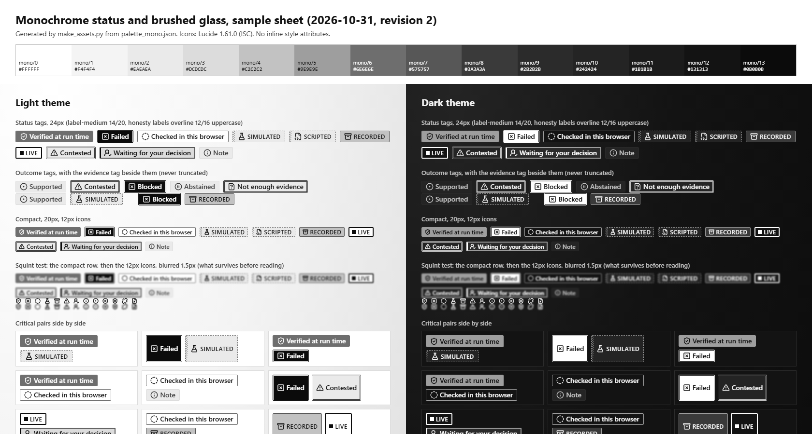
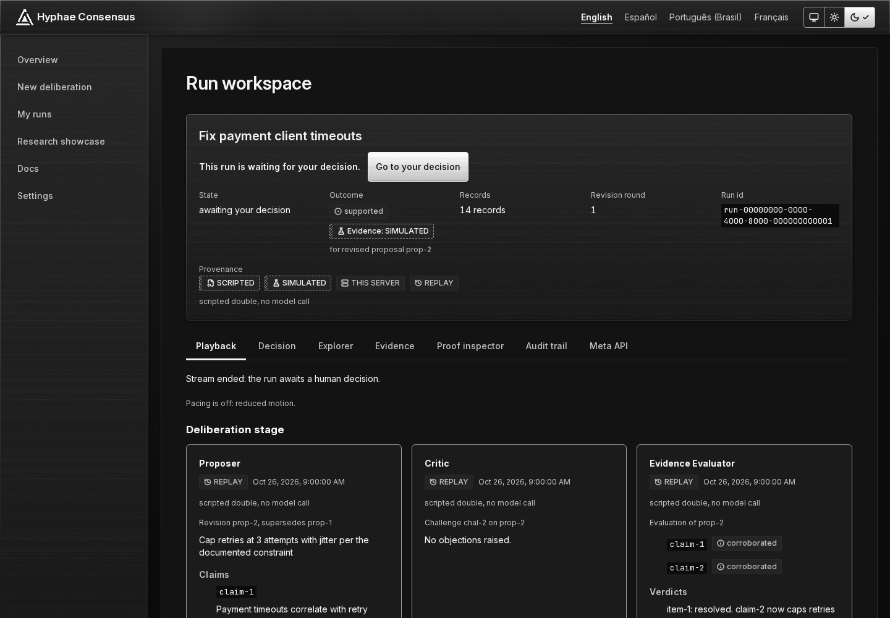
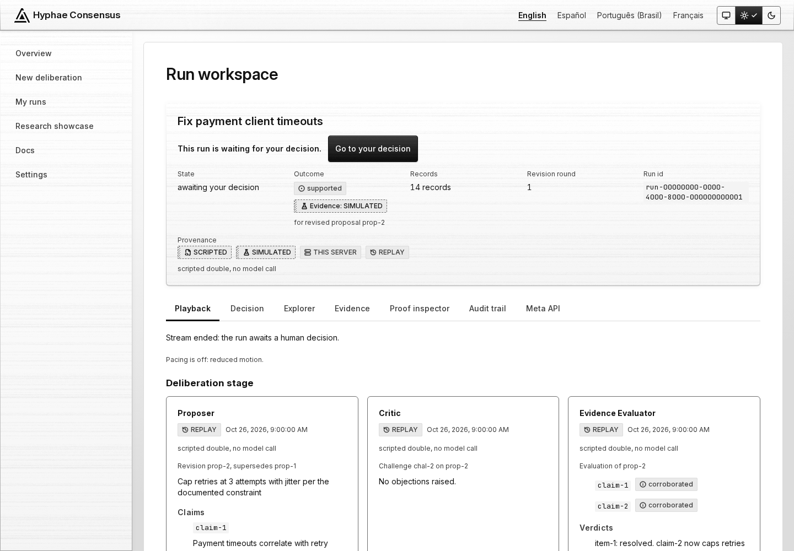
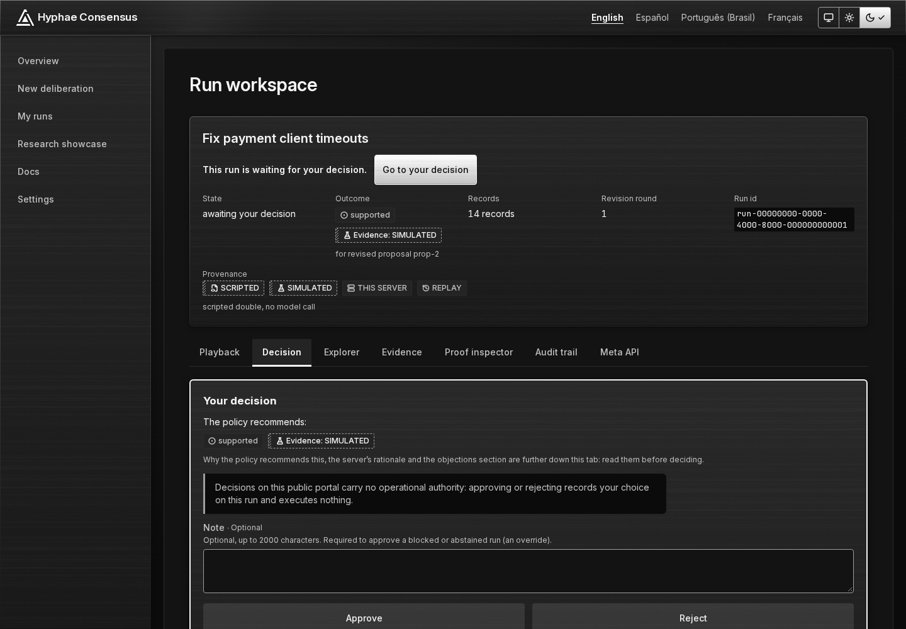

<!-- SPDX-License-Identifier: Apache-2.0 -->

  

# Design kit

How the Hyphae Consensus portal looks and why. The portal is monochrome (true greys, no hue), made of square-first shapes and brushed glass, and every honesty label (SIMULATED, SCRIPTED, RECORDED, LIVE, verified, failed) is told apart without colour. This folder publishes the part of the 2026-10 redesign that is worth reading or reusing: the rules, the tokens, the logo, curated screenshots and the heuristic evaluation that started it.

Contents: [Why](#why-these-choices) · [Status without colour](#status-without-colour) · [Honesty labels in four languages](#honesty-labels-in-four-languages) · [Shape, type, icons, motion](#shape-type-icons-motion) · [Screens](#screens) · [How it was produced](#how-it-was-produced) · [Where it lives in the code](#where-it-lives-in-the-code) · [Credits](#credits) · [Files](#files)

## Why these choices

The product's job is to show what is known and what is not. A palette with a green "good" and a red "bad" works against that: the first heuristic evaluation (2026-10-30, [summary](heuristic-evaluation.md)) found simulated work painted solid green, and green is read as "verified" before anyone reads the word next to it. So the redesign took colour out of the status system entirely.

- **Monochrome, no hue.** Fourteen greys from `#FFFFFF` to `#0B0B0B`, R = G = B on every step ([tokens](tokens.md)). A build check fails on any colour literal whose channels differ. The screenshots in this folder were measured: every pixel has equal red, green and blue.
- **Brushed glass.** Cards, panels, the top bar and overlays use a frosted, almost opaque glass with a fine horizontal grain, lit from the top left, in greys only. It gives depth without colour. It is used sparingly: dense data (tables, code, long text, tags, inputs) stays on solid surfaces, and every glass rule has a fallback (no blur support, reduced transparency, more contrast, forced colours, print).
- **Square first.** Radii are 0, 2, 4 and 6 px. No pills, no ovals, no chat bubbles. Regions and tables are square; tags are 2px rectangles; controls 4px; cards and dialogs 6px. Status markers are squares. The only round things left are radio marks, which keep their shape so they still read as radios.
- **Order through the grid.** Flush-left text, an 8px rhythm, prose capped near 40rem, one primary action per screen.
- **Say it in words.** Every status has a visible word. Icons are decorative and `aria-hidden`; colour (here, grey value) is the third cue, never the first.

## Status without colour

Each status is encoded on up to eight channels: fill, polarity (inverted or not), frame, an edge mark or marker, icon, word and letter case, plus line style. Five of them are *pre-attentive*, meaning they are seen before the word is read, and survive blur and 12px icons. The design's measured rule: every pair of roles differs in at least three channels and one pre-attentive channel; the fourteen critical pairs (for example verified / simulated, failed / live) in at least four channels and two pre-attentive ones. One pair, "checked in this browser" against "info", is a named, accepted exception that differs only by its frame, icon and word.

*The design's proof sheet (revision 2, 2026-10-31), rendered from the stylesheets. It is the reference for the encoding, not a screenshot of a page.*

| Role | What it means | How it looks |
|---|---|---|
| **SIMULATED / SCRIPTED** | Nothing real was checked; roles were scripted | Light tint, **1px dashed** frame, a **hatch** strip (4px on tags, 8px band on panels and rows), flask or code icon, UPPERCASE. Never solid, never a check mark |
| **RECORDED** | Read back from the archive, read-only | **Mid-tint** fill (`mono/4` light, `mono/8` dark), 1px solid frame, archive icon, UPPERCASE |
| **LIVE** | Delivered live by a run that is really live (and only then) | Surface fill, **2px ink frame**, an **8px solid square** marker that pulses three times and then stops; no icon |
| **Verified at run time** | A real verifier accepted a real proof | **Solid, inverted** grey block (`mono/6` light, `mono/5` dark), shield-check icon, no frame |
| **Checked in this browser** | Bytes match the fingerprints they are compared with, nothing more | **Hollow**: surface fill, 1px frame, dashed-circle icon |
| **Failed / blocked / chain broken** | A real error | **Maximum ink**, inverted, inside a **double frame**; square-x, shield-x, unlink or file-x icon. The only role that is a solid with a frame |
| **Contested / not enough evidence** | A caveat a human must weigh | Light tint, **3px double** line, triangle or file-question icon |
| **Waiting for your decision** | You are the next step | Strong tint, **2px solid** frame, a 3px ink bar on the inline-start edge, user icon |
| **Note** | Information | Quietest: tint, no visible frame, info icon |

The meaning of the line styles is fixed. Dashed means *not real data*. Double means *there is a problem*. Thick solid means *now, or you*. A 1px solid line is a neutral boundary. Luminance reads as an ordinal of how settled something is: failed at maximum ink, then verified, then recorded, pending, the tints, and the plain surface.

Two rules from the original brief ("honesty rules") are carried through every screen: a simulated proof never looks verified, and integrity is not truth. A hash-chain or manifest check says the bytes match a fingerprint, not who wrote them or that they are correct; a valid proof says a record matches what Hyphae sealed, not that it is true, relevant or complete. Those sentences sit at the point of reading. Decisions carry a "no operational authority" notice directly above Approve and Reject, and the two buttons have equal weight.

Under forced colours (Windows High Contrast) fills and hatch disappear, so each status survives as border style, icon and word: SIMULATED keeps its dashed border, verified and failed stay inverted blocks, contested keeps its double line, LIVE its square. The design's check of that (Chrome `--force-high-contrast`) is noted in the source documents; the shipped stylesheet carries the rules (`hc-mono-glass.css`, `globals.css`).

## Honesty labels in four languages

The labels are translated, not left in English (owner decision, 2026-10-31). Tags wrap and are never truncated, so the longest locale (+30 %) still shows its whole qualifier. These are the strings in `apps/web/messages/*.json` (`Provenance.*.label`).

| Label | English | Español | Português (Brasil) | Français |
|---|---|---|---|---|
| Simulated | SIMULATED | SIMULADO | SIMULADO | SIMULÉ |
| Scripted | SCRIPTED | CON GUION | ROTEIRIZADO | SCÉNARISÉ |
| Recorded | RECORDED | GRABADO | GRAVADO | ENREGISTRÉ |
| Replay | REPLAY | REPRODUCCIÓN | REPRODUÇÃO | REJEU |
| Live | LIVE | EN VIVO | AO VIVO | EN DIRECT |
| Live Meta model | LIVE META | META EN VIVO | META AO VIVO | META EN DIRECT |
| Meta model | META MODEL | MODELO META | MODELO META | MODÈLE META |
| No evidence | NO EVIDENCE | SIN EVIDENCIA | SEM EVIDÊNCIAS | AUCUN ÉLÉMENT PROBANT |
| This server | THIS SERVER | ESTE SERVIDOR | ESTE SERVIDOR | CE SERVEUR |

Outcome and evidence are two separate tags (`supported`, then `Evidence: SIMULATED`), so the qualifier is never cut off: the first evaluation found "respaldada — con eviden…" in Spanish, which lost SIMULADO entirely.

## Shape, type, icons, motion

- **Type.** Inter for the interface and prose, JetBrains Mono for hashes, ids, digests and code, with a slashed zero so `0` and `O` never mix. Sizes as shipped are in [tokens](tokens.md#type); they are the Astryx scale (14px body), not the larger scale of the Figma file.
- **Icons.** [Lucide](https://lucide.dev) (ISC), 24-unit grid, 1.5px stroke at every size, `currentColor`, redrawn as inline SVG (`apps/web/src/components/icons.tsx`, 33 shapes) so there is no icon dependency and no style attribute. `square-x` replaced `octagon-x` for failures, because the octagon's rounded corners read as a circle at 12 and 16px.
- **Motion.** Small and functional: the drawer slides, dialogs rise 0.5rem and fade, nothing loops except the in-progress spinner and the LIVE square, which pulses three times (floor opacity 0.6, still at 5.2:1) and then stays still. `backdrop-filter` is never animated. Under reduced motion (OS or in-app setting) there is no translation or scale, overlays only fade, and the LIVE square is static. Details: [tokens](tokens.md#motion).
- **Logo.** Quorum: three identical facets (Proposer, Critic, Evaluator) lean on one another around a node, the decision. See [logo](logo/README.md).

## Screens

Nine images in [`screens/`](screens), all pure greys. Shown here: the run workspace in dark and in light.

| File | What it shows | Route |
|---|---|---|
| [`run-awaiting-dark.png`](screens/run-awaiting-dark.png) | Run header with the answer sentence and "Go to your decision", outcome and `Evidence: SIMULATED` tags, provenance strip (SCRIPTED, SIMULATED, THIS SERVER, REPLAY), tabs, role cards | `/en/run/?id=…` |
| [`run-awaiting-light.png`](screens/run-awaiting-light.png) | The same page in the light theme | `/en/run/?id=…` |
| [`run-awaiting-es-dark.png`](screens/run-awaiting-es-dark.png) | The same page in Spanish: CON GUION, SIMULADO, REPRODUCCIÓN, nothing truncated | `/es/run/?id=…` |
| [`run-header-mobile-dark.png`](screens/run-header-mobile-dark.png) | The same page at 390px: tags wrap, tabs wrap, no horizontal overflow | `/en/run/?id=…` (Decision tab) |
| [`decision-dark.png`](screens/decision-dark.png) | Decision tab: recommendation as two tags, the no-authority notice, an optional note, Approve and Reject at equal weight | `/en/run/?id=…` |
| [`chain-broken-dark.png`](screens/chain-broken-dark.png) | Audit trail after "Check the chain" on a log with one altered record: "Chain check failed" and `differs` in the failed role (inverted, double frame) | `/en/run/?id=…` |
| [`runs-list-dark.png`](screens/runs-list-dark.png) | My runs: status tags in cards (SCRIPTED, SIMULATED, NO EVIDENCE; awaiting your decision; blocked; insufficient evidence) | `/en/runs/` |
| [`showcase-recorded-dark.png`](screens/showcase-recorded-dark.png) | Research showcase: RECORDED archive runs, the manifest check ("Matches", checked in this browser) with its standing sentence | `/en/showcase/` |
| [`status-encoding-sheet.png`](screens/status-encoding-sheet.png) | The status proof sheet described above | not a page |

**Provenance of these images.** Page screenshots (all but the sheet) were taken from the static export at `255f21c`, built and run only in the repository's pinned Docker images (Playwright 1.64.1, Chromium, 1440 px wide, 390 px for the mobile one, reduced motion, over the end-to-end suite's mocked API; no server, no network, no model call). The data is the contract fixtures in `contracts/api-v1/fixtures` and the public `research/` archive: a guided "Fix payment client timeouts" run, scripted and simulated, with the fixtures' 26 October 2026 timestamps. They contain no emails, tokens, judge codes or other secrets. They are the app's own mock, not captures of the live site, and no live run is shown (a LIVE state exists in the app, but the only way to render it here was a mock, so it is left out). Converted to 8-bit greyscale PNG, each under 200 KB. The status sheet is the 1x render of the design's `sample-sheet.html`, cropped to its first 900 rows.

## How it was produced

The direction was written as a binding specification (principles, information architecture, tokens, components, per-screen briefs, a Figma build plan) from an inventory of the app's 230 screens and states, then built in Figma as **"Hyphae Consensus — Redesign 2026-10"** with foundations (variables for colour, radius, type and spacing in light and dark), components and screens pages. That Figma file is not public. If the owner shares it, a link will be added here. Colour values were not picked by eye: a script computes WCAG 2.2 contrast for every text and non-text pair in both themes (the last run: 740 of 740 required pairs pass, strict, including 184 worst-case pairs on glass), a distinctness matrix over the status roles and a lint of the stylesheets. The glass and status were then implemented in the app in the following rounds and checked by unit and end-to-end tests.

What this folder does *not* contain: the Figma file, the specification documents themselves (about 700 KB of working notes, with review logs), the five discarded logo explorations, or the per-screen briefs. They were working material.

## Where it lives in the code

| Design piece | Code |
|---|---|
| Neutral scale, functional and role tokens, glass stops | [`apps/web/src/app/hc-mono-tokens.css`](../../apps/web/src/app/hc-mono-tokens.css) |
| Brushed glass, ink button, fallbacks | [`apps/web/src/app/hc-mono-glass.css`](../../apps/web/src/app/hc-mono-glass.css) |
| Tags, callouts, rows, links, shapes, motion | [`apps/web/src/app/globals.css`](../../apps/web/src/app/globals.css) |
| Theme (type, radii, durations, hue families pointed at greys) | [`apps/web/src/theme/hyphae-mission.css`](../../apps/web/src/theme/hyphae-mission.css) |
| Roles, icons and labels per status | [`apps/web/src/lib/provenance.ts`](../../apps/web/src/lib/provenance.ts), [`Tag.tsx`](../../apps/web/src/components/Tag.tsx), [`Callout.tsx`](../../apps/web/src/components/Callout.tsx), [`OutcomeTags.tsx`](../../apps/web/src/components/OutcomeTags.tsx) |
| Lucide icons | [`apps/web/src/components/icons.tsx`](../../apps/web/src/components/icons.tsx) |
| Quorum mark | [`apps/web/src/components/Quorum.tsx`](../../apps/web/src/components/Quorum.tsx), `apps/web/public/brand/quorum-glass-64-*.svg`, favicons in `apps/web/public/` |
| Grain and hatch tiles | `apps/web/public/brand/` |
| Fonts | [`apps/web/src/app/fonts.ts`](../../apps/web/src/app/fonts.ts) |
| Translated labels | `apps/web/messages/{en,es,pt-BR,fr}.json` |
| Tests that hold the rules | `apps/web/tests/{tags,glass,no-hue,radius-scan,contrast}.test.ts`, `apps/web/e2e/{tag-encoding,glass,no-hue,shapes,responsive,outcome-tags}.spec.ts` |

## Credits

- **Lucide** icons, ISC licence, Copyright (c) 2026 Lucide Icons and Contributors; some shapes derive from Feather (MIT, Copyright (c) 2013-present Cole Bemis). The shapes are redrawn in `icons.tsx`, which carries the notice. This folder contains no icon file.
- **Inter** (Copyright (c) 2016 The Inter Project Authors) and **JetBrains Mono** (Copyright 2020 The JetBrains Mono Project Authors), SIL Open Font License 1.1. This folder contains no font file; the screenshots and the logo's outlined wordmark render with them. The licence texts ship with the site and the full notices are in [`THIRD_PARTY_NOTICES.md`](../../THIRD_PARTY_NOTICES.md) (Fonts, Icons).
- The design is Apache-2.0 like the rest of the repository. The Quorum mark is part of this project; use it to refer to Hyphae Consensus. The project is independent and not affiliated with, sponsored by, or endorsed by Meta.

## Files

| Path | What |
|---|---|
| [`tokens.md`](tokens.md) | Every token as shipped, with its source file |
| [`heuristic-evaluation.md`](heuristic-evaluation.md) | The 2026-10 evaluation: method, defects, fixes, what remains |
| [`logo/`](logo/README.md) | The Quorum kit (SVG first) and its construction |
| [`screens/`](screens) | Nine curated images |
