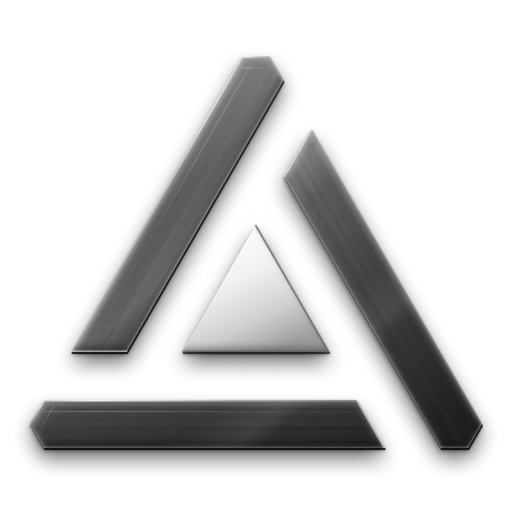
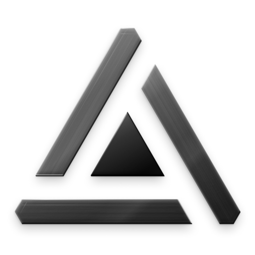

<!-- SPDX-License-Identifier: Apache-2.0 -->

# Quorum, the Hyphae Consensus mark (v1.0, 2026-10-31)

  
  

Three identical facets (Proposer, Critic, Evaluator) lean on one another in turn around a central node: the decision. The material is brushed smoked glass with depth. The palette is fully monochrome: greys from `#000000` to `#FFFFFF`, R = G = B everywhere, no hue. Every edge is sharp and every corner is 60 or 120 degrees. (The two PNGs above are 512 px versions of the 1024 px masters, transparent background.)

Contents: [Files](#files) · [Construction](#construction-64-unit-grid) · [Glass recipe](#glass-recipe) · [Wordmark and lockups](#wordmark-and-lockups) · [Clear space and sizes](#clear-space-and-minimum-sizes) · [Do and don't](#do-and-dont) · [Limits](#limits-and-checks)

## Files

SVG is the source; PNGs are included only where SVG cannot do the job (the glass frost is a backdrop blur, which SVG does not have) or for a platform that wants a raster.

| File | What it is |
|---|---|
| `mark-glass.svg`, `mark-glass-light.svg` | Glass mark for dark / light surfaces, transparent, 1024 canvas. Self-contained: no style element or attribute, no script, no external reference. No frost (SVG cannot) |
| `mark-glass-512.png`, `mark-glass-light-512.png` | The same with the frost, 512 px, transparent. Downscaled from 1024 px masters rendered from the design file; built from two renders (on black and on white) by a difference matte, so the soft shadow has no speckled halo |
| `mark-glass-64.svg`, `mark-glass-64-light.svg` | Dedicated small glass for 64 to 192 px: no brush, no wall, 1px rims at 64 px, a brighter body on dark |
| `mark-flat-black.svg`, `mark-flat-white.svg` | Flat master on the 64 grid, one ink |
| `mark-flat-32-*.svg`, `mark-flat-16-*.svg` | Hand-set whole-pixel cuts for 24 to 39 px and 16 to 23 px. The 16 px files have no style element, so they are safe to inline |
| `favicon.svg` | The 16 px cut, ink `#141414`, or `#EDEDED` in dark mode through its own media query. **Link it, never inline it** (the app's CSP is hash-only; to inline use `mark-flat-16-*.svg`) |
| `favicon-16.png`, `favicon-32.png` (+ `-white`) | PNG fallbacks generated from the pixel maps, transparent |
| `app-icon-1024-dark.svg`, `app-icon-1024-light.svg` | 1024 square tiles with corner radius 0 (the platform applies its mask) |
| `app-icon-512-dark.png`, `app-icon-512-light.png` | The tiles at 512 px |
| `apple-touch-icon-180.png` | Dark tile at 180 px using the 64 px glass |
| `lockup-horizontal-black/white.svg`, `lockup-stacked-black/white.svg` | Flat mono lockups; the wordmark is outlined |
| `lockup-horizontal-glass-dark/light.svg`, `lockup-stacked-glass-dark/light.svg` | Glass mark with a flat wordmark (`#F2F2F2` on dark, `#141414` on light). Only when the mark is 64 px or taller |

The generators (Python, run with `python -I`) are not in this repository. The shipped copies of the mark are in [`../../assets/logo/`](../../assets/logo) (used by the root README) and `apps/web/public/` (favicons, icons, Open Graph image).

## Construction (64-unit grid)

- **Triangle:** equilateral, side 60, base on y 56 (x 2 to 62), centroid (32, 38.679).
- **Facets:** three congruent pinwheel facets. The Proposer is the base, the Critic is on the right, the Evaluator is on the left. Each owns one corner and leans on the next.
- **Band and gaps:** band 6, facet gaps 6 measured square to the edges, and the node ring is also 6, so every gap reads equal.
- **Node:** an equilateral triangle, side 18.475, on the centroid: (32, 28.038), (22.785, 44), (41.215, 44).
- **Corners:** all three truncated alike (flat 3.464, depth 3, half the band). No facet ends in a point.
- **Angles:** straight segments only; every corner is 60 or 120 degrees (the build script asserts it).
- **Facet coordinates:**
  - Proposer: (5.464,56) (48.144,56) (44.679,50) (5.464,50) (3.732,53)
  - Critic: (60.268,53) (38.928,16.038) (35.464,22.038) (55.072,56) (58.536,56)
  - Evaluator: (30.268,7.038) (8.928,44) (15.856,44) (35.464,10.038) (33.732,7.038)
- **Symmetry:** three-fold rotational. A pinwheel cannot be mirror-symmetric under the 60/120 rule; the direction of the turn shows only in the gaps.
- **32 px cut:** whole pixels; sides step 1 px every 2 rows (63.4 degrees, not a true 60). Facets, gaps and ring are 3 px on every row with no diagonal contact. The apex is a 4 px flat; the node runs 2-2-4-4-6-6-8-8-10.
- **16 px cut:** facets, gaps and ring are 2 px on every row, no diagonal contact. The apex is a 4 px flat; the node runs 2-2-4-4 (12 px). The ink occupies rows 1 to 14 with no side margin: a 2 px ring and a larger node do not both fit.

## Glass recipe

Values are on the 1024 canvas. One light source, above-left, unit vector (-0.34, -0.94); every highlight, wall and shadow follows it.

| Part | Dark surfaces | Light surfaces |
|---|---|---|
| Body gradient (360,80) to (660,920) | `#A6A6A6` 70% · `#6A6A6A` 58% @.38 · `#383838` 62% @.75 · `#1E1E1E` 74% | `#8C8C8C` 86% · `#5C5C5C` 88% @.40 · `#333333` 90% @.78 · `#1F1F1F` 92% |
| Frost (design file and PNGs only) | background blur 24 | same |
| Brush | 150 seeded hairlines along each facet's long edge, 1.2 to 4.8 px wide, white 0.75 / 1.25 / 1.75 %, black 4 %. In SVG: `feTurbulence` fractal noise, base frequency "0.0018 0.28", 3 octaves, seed 11, 5 % | white 0.6 / 1 / 1.5 %, black 3.5 %; SVG 4.5 % |
| Grain | monotone white 4 %; SVG `feTurbulence` 0.9, seed 3, 3.5 % | same; SVG 3 % |
| Sheen | diagonal (120,110) to (900,1010), white 0 / 18 / 3 / 0 / 8 / 0 % | the same × 0.8 |
| Rims (3 px, inside the edge) | lit edges white, alpha .15 + .80 · max(0, n·L)^1.3; shadow side white 18 % | lit .12 + .70 · …; shadow side black 45 % |
| Leading end | the cut end of each facet (where the turn passes on): white 55 % | white 50 % |
| Wall | thin uniform edge offset (1.5, 4): `#3C3C3C` to `#121212` at 95 % | `#2A2A2A` to `#0A0A0A` at 92 % |
| Shadow | drop black 55 % y22 r44, contact black 50 % y6 r10 | 22 % and 25 % |
| Node | `#FFFFFF` · `#F2F2F2` @.40 · `#CFCFCF` @.72 · `#9A9A9A`, glow white 12 % r56 | graphite `#5A5A5A` · `#303030` @.40 · `#080808`. Always the densest element on light |
| Stage (hero, app icon) | radial `#2B2B2B` · `#121212` @.55 · `#060606` + white 10 % backlight | linear `#F7F7F7` to `#D9D9D9` |

**Small glass (64 to 192 px):** no brush, no wall, no caustic; rims 1 px at 64 px; dark body `#BDBDBD` 80 % · `#828282` 72 % · `#4E4E4E` 74 % · `#333333` 82 %; light body `#7A7A7A` 92 % to `#1C1C1C` 96 %. A Figma blur radius is about 2× an SVG `stdDeviation`.

## Wordmark and lockups

- **Wordmark:** "Hyphae Consensus" in Inter Semi Bold (600), tracking -1.5 % (-0.015 em), sentence case. Always flat and monochrome, never glass, never retyped in another weight. The SVGs carry the outlined version, so no font is needed.
- **Horizontal lockup:** cap height = node apex to base (27.96 u; font size 38.45 u). The baseline sits on the triangle base; the wordmark starts at x 74 (12 u after the base corner). Size 424.135 × 64.
- **Stacked lockup:** cap height 12 u (font size 16.5 u); the cap top sits 12 u below the base, centred on the mark axis. Size 153.406 × 85.375.
- **Ink:** `#F2F2F2` on dark, `#141414` on light, pure `#000000` / `#FFFFFF` in print.

## Clear space and minimum sizes

Clear space x = 12 grid units (band + gap) = 3/16 of the mark box, kept clear on every side of the ink bounds of the mark or the lockup. For the mark alone at 64 px, x = 12 px.

| Use | Size |
|---|---|
| Glass, 1024 master | 256 px and up (screen only) |
| Glass, 64 component | 64 to 192 px |
| Threshold | **below 64 px, always flat** |
| Flat master | 40 px and up, any medium |
| 32 px cut | 24 to 39 px (render at exactly 32 when possible) |
| 16 px cut | 16 to 23 px; the favicon |
| Never | below 16 px |
| Horizontal lockup | mark at least 24 px tall (about 160 px wide); glass lockup only with a mark of 64 px or more |
| Stacked lockup | at least 96 px wide |
| Print | flat only; mark at least 8 mm, horizontal lockup at least 30 mm wide |

The app icon tile is a square with corner radius 0; the platform applies its own mask. The mark fills 72 % of the tile (12 % safe margin). A 64 px tile carries a 46 px mark, below the threshold, so it uses the flat mark. In the app, the 32 px cut sits in the 56 px top bar and glass is used only for marks of 64 px or more (the empty state, the decision panel).

## Do and don't

**Do:** use glass from 64 px up on a calm ground with the material that matches it; use the flat cuts below 64 px; keep the clear space; keep the node at the highest contrast (white on dark, graphite on light); use one ink in print.

**Don't:**
- add a hue: no tint, no accent node, no coloured gradient or glow;
- round the corners or add curves;
- mirror or rotate the mark: the turn runs one way;
- extrude it into a deep 3D bar (it reads as a Penrose triangle; depth comes from shadow and translucency);
- outline the mark or close the gaps;
- use glass below 64 px;
- retype, reweight or re-track the wordmark;
- put glass on a busy photo without a calm stage behind it.

## Limits and checks

Said plainly, because a logo README tends to oversell.

- **Not applied from the design review:** a mirror-symmetric silhouette (the pinwheel cannot be, see above); the "A", delta and up-arrow reading is weaker but not gone, and at 16 to 64 px the long left facet still reads somewhat like the leg of an "A"; the 16 px node is 12 px, not larger, and has no side margin.
- **Look-alikes, by eye only:** low to moderate against Avalanche, low against the Penrose triangle and the recycling symbol, moderate at 16 to 32 px against "A" monograms and the Google Drive triangle. This is not a register search and not legal clearance. A trademark search (EUIPO and USPTO design codes for triangles) is the next step before any registration.
- **Checks run on the design:** zero non-neutral paints in the design file (every fill, stroke, gradient stop and effect colour has R = G = B); pixel-cut gaps checked by script; the SVGs rendered in headless Chrome from 1024 down to 64 px on five grounds; the PNGs composited on dark and light grounds. Contrast in the brand sheet's mock-up was estimated from hex values (about 5:1 or better), not measured with a tool.
- The five other logo concepts explored first are not part of this kit.
